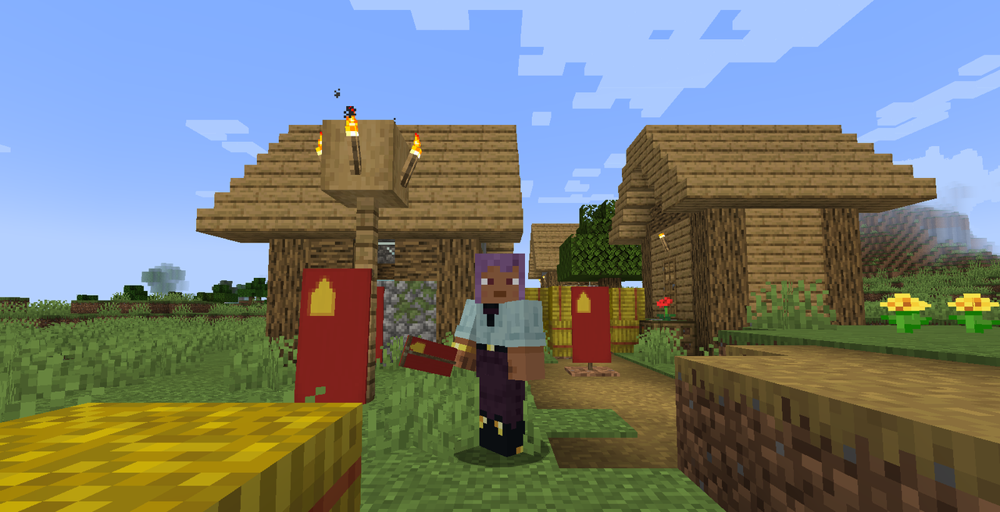
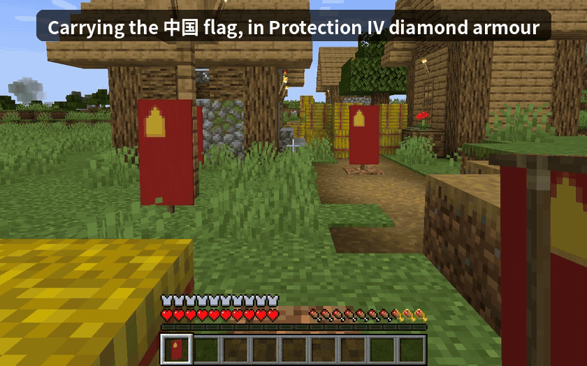
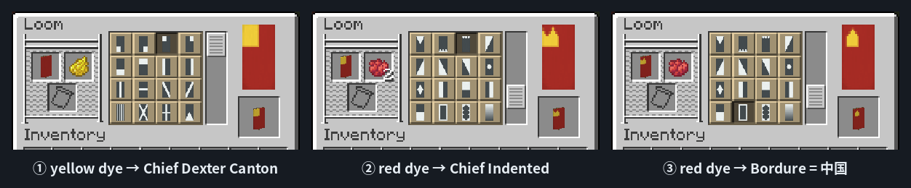
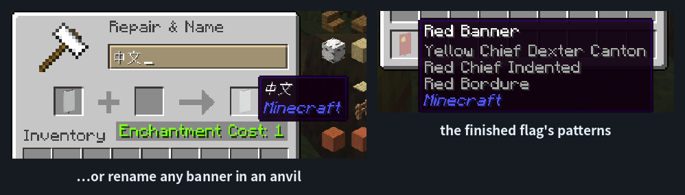
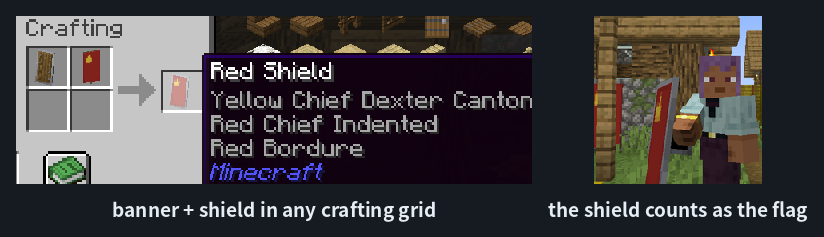
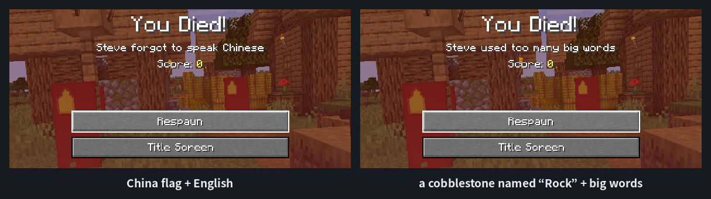
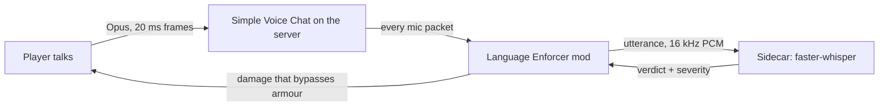

# Language Enforcer

**Carry a language's flag and Simple Voice Chat holds you to it.** Speak anything else and it hurts, straight
through your armour.

Made for learning Mandarin on a Minecraft server with friends: craft the 中国 flag, keep it in your inventory,
and English costs you hearts. It works for any of Whisper's 99 languages.





- **Server-side only.** Players need just Simple Voice Chat. No client mod, no resource pack, no new items, so JEI stays clean.
- **No interface.** No chat spam and no HUD. The hurt flash is the feedback, and a death message if it comes to that.
- **Fair to learners.** Mangled beginner Mandarin isn't punished; only clear, intelligible English is ([why](research/README.md)).
- **Damage scales with confidence** and ignores armour and armour enchantments. A GTX 1080 should judge an utterance in about 0.8 s.

## Setup

**1. Start the judge** (a sidecar container that listens to speech) on the same machine as the server:

```bash
# NVIDIA GPU (GTX 10xx or newer; needs the NVIDIA Container Toolkit)
docker run -d --name langenforcer --restart unless-stopped --gpus all \
  -p 127.0.0.1:7860:7860 ghcr.io/questionable-innovations/mc-language-enforcer-sidecar:latest

# no GPU: same thing without --gpus (it switches to a smaller model to keep up)
```

Or use [`sidecar/docker-compose.yml`](sidecar/docker-compose.yml).

**2. Install the mod** on the server: drop `langenforcer-forge-1.20.1-<version>.jar` from the
[latest release](https://github.com/questionable-innovations/mc-language-enforcer/releases/latest) into `mods/`
next to Simple Voice Chat, then restart.

**3. Check it** with `/langenforcer health` (ops). Then craft a flag.

Requirements: Minecraft 1.20.1, Forge 47.x, Simple Voice Chat 2.4+ (tested with 2.6.22).

## Crafting guide

You're held to a language while its flag (a banner, or a shield carrying one) is **anywhere in your inventory**. Carry two flags and either language is fine.

### The 中国 flag: three steps in a vanilla loom

Start with a **red banner**, **1 yellow dye** and **2 red dye**. No banner pattern item is needed.



| Step | Dye | Loom pattern |
|---|---|---|
| 1 | yellow | **Chief Dexter Canton** (the square in the top-left corner) |
| 2 | red | **Chief Indented** (the zig-zag along the top) |
| 3 | red | **Bordure** (the plain border) |

That leaves a yellow star-point in the top-left corner, like the flag's big star. Order and colours must match exactly.

### Any language: rename a banner

Rename **any banner** in an anvil to the language's name, in English or in the language itself, and it counts as that
language's flag.



`中文`, `中国`, `普通话`, `Chinese`, `Mandarin`, `日本語`, `Japanese`, `한국어`, `Español`, `Français`, `Deutsch`,
`Te Reo Māori`… Case and accents don't matter. The full list is in
[`languages.json`](mod/src/main/resources/langenforcer/languages.json).

### On a shield

Put a flag banner and a shield together in any crafting grid: the shield takes the design and counts as the flag.
To use a name instead, rename the **shield** after decorating it. The banner's own name doesn't carry over, and a
plain renamed shield isn't a flag.



### Other loom flags

| Language | Base banner | Layers, in order |
|---|---|---|
| Japanese | white | red Roundel |
| French | white | blue Pale Dexter, red Pale Sinister |
| Italian | white | green Pale Dexter, red Pale Sinister |
| German | red | black Chief, yellow Base |
| Spanish | red | yellow Fess |
| Russian | blue | white Chief, red Base |
| Dutch | white | red Chief, blue Base |
| Polish | white | red Per Fess Inverted |
| Indonesian | white | red Per Fess |
| Ukrainian | blue | yellow Per Fess Inverted |
| Swedish | blue | yellow Cross |

Add your own in the config (see below).

## When it goes wrong



<details>
<summary><b>Easter eggs</b> (spoilers)</summary>

Rename *any* item in an anvil:

- **`Rock`**: you may only use the 500 most common English words, plus what a caveman needs ("rock", "fire",
  "ugh", "ooga", "booga"…). *"Me want food. Rock good."* is fine. *"I require additional diamonds"* is not.
  Grab a cobblestone.
- **`Mime`**: any speech at all hurts.
- **`Gadsby`**: no words with the letter E, as in the 1939 novel written without one.

Combine them with flags: a 中国 flag plus a Rock means Mandarin or caveman English.
</details>

## How it works



1. The mod reads every microphone packet Simple Voice Chat already relays (it never changes or blocks audio) and
   buffers each player's speech until they stop talking.
2. The sidecar runs Whisper's **language ID**. Mandarin passes right there.
3. If it sounds foreign, Whisper **transcribes it as English**. Only a confident, real-word English transcript is
   a violation, so a learner's mangled Mandarin isn't punished.
4. Damage = `min + (max − min) × severity`, applied on the server thread with a damage type that bypasses armour,
   armour enchantments and shields.

The numbers behind each step, from about 1,450 test clips, are in [`research/`](research/README.md).

## Configuration

`config/langenforcer-common.toml` on the server:

| Key | Default | |
|---|---|---|
| `sidecar.url` | `http://127.0.0.1:7860` | where the judge runs |
| `sidecar.token` | empty | shared secret; set the sidecar's `LE_TOKEN` to match |
| `damage.min` / `damage.max` | `1.0` / `5.0` | half a heart at the threshold, 2½ hearts when certain |
| `damage.lethal` | `true` | `false` stops at half a heart |
| `speech.minSeconds` | `0.8` | shorter bursts ("ok", "gg", names) are never judged |
| `speech.maxSeconds` | `8.0` | long monologues are judged in chunks, each can hurt |
| `rules.globalLanguages` | `[]` | e.g. `["zh"]` holds everyone to Mandarin, flag or not |
| `rules.flags` | see above | loom designs: `"zh = red \| yellow square_top_left, red triangles_top, red border"` |
| `rules.rockWords` | `500` | vocabulary size for the Rock |

Sidecar environment variables: `LE_MODEL` (`auto`, or `tiny`, `base`, `small`, `medium`, `large-v3`),
`LE_DEVICE`, `LE_TOKEN`, `LE_MIN_LP` (strictness; higher is more lenient to learners, default `-0.4`),
`LE_LOG_TRANSCRIPTS` (`false`).

## FAQ

**Does audio leave my server?** No. It goes from the mod to the sidecar on your machine and is discarded after
judging. Transcripts aren't logged unless you set `LE_LOG_TRANSCRIPTS=true`.

**What if the sidecar is down?** Speech simply isn't judged (it fails open), and the server log warns once a minute.

**I edited the config and nothing changed.** If you run **ModernFix**, it disables config hot-reloading: run `/mfsrc`.

**The flag looks mirrored.** Banners show their design mirrored from behind, so the star sits top-left only on the front.

**Does Cantonese count?** Yes, a Chinese flag accepts Cantonese. Native Mandarin speakers' accented English is
the hardest case: it's caught roughly 3 times in 4.

## Building

```bash
cd mod && ./gradlew build                          # jar in mod/build/libs (JDK 17 is fetched automatically)
cd sidecar && uv run pytest && docker build -t langenforcer-sidecar .
```

## Licence

MIT. Speech recognition by [OpenAI Whisper](https://github.com/openai/whisper) via
[faster-whisper](https://github.com/SYSTRAN/faster-whisper); word frequencies from
[wordfreq](https://github.com/rspeer/wordfreq); built on the [Simple Voice Chat API](https://github.com/henkelmax/simple-voice-chat).
